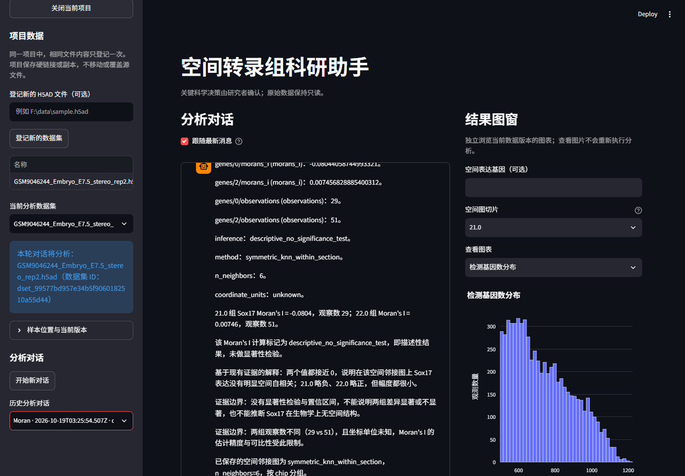
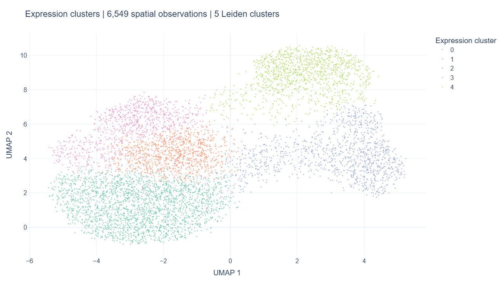
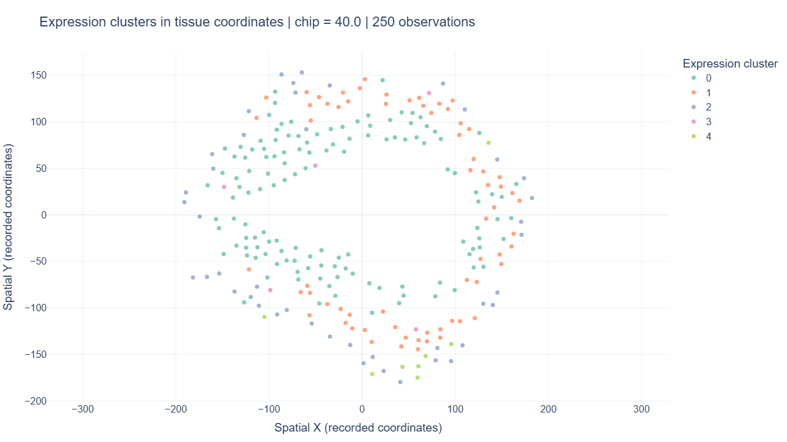

# 🧬 ST Agent V2

**用自然语言推进空间转录组分析，让数据处理、空间统计和结果解释连接起来。**

ST Agent 是面向空间转录组研究者的本地科研助手。登记 H5AD 后，可在对话中完成数据检查、QC、过滤、预处理、聚类和 marker 分析，继续探索切片内空间自相关与区域结构，并查看图表、保存结果和导出报告。

[安装与使用](USER_GUIDE.md) · [下载 V2](https://github.com/talented-canola/st-agent/releases/latest)

## 运行界面

左侧管理项目与数据，中间进行分析对话，右侧查看当前版本的结果图。



*已有实际运行截图，展示对话、来源入口和交互图窗。*

## 能做什么

| 分析阶段 | 功能 |
|---|---|
| 了解数据 | 规模、计数来源、已有处理状态、空间坐标及分组信息 |
| 质量控制 | 总计数、检测基因数、线粒体比例与明确阈值过滤 |
| 表达分析 | 标准化、log1p、高变基因、PCA、Leiden、UMAP与marker排序 |
| 空间分析 | 切片内邻接图、Moran I、纯坐标分区、表达与空间联合域 |
| 切片比较 | 分组QC、基因表达与对齐簇组成的描述性比较 |
| 结果交付 | 交互图窗、保存表格、来源与数据版本、HTML报告 |

## 快速开始

需要 **Python 3.11**。进入项目根目录后：

```powershell
conda create -n st_agent_v2 python=3.11 -y
conda activate st_agent_v2
python -m pip install -e ".[ui,knowledge]"
Copy-Item .env.example .env
```

在本机 `.env` 填写自己的 API Key、服务地址与模型名称，然后启动：

```powershell
python -m streamlit run app.py
```

打开终端显示的本地网址，通常为 `http://localhost:8501`。`.env` 仅留在本机。

## 从第一句话开始

1. 在左侧输入新的项目文件夹路径，点击“在该路径新建项目”。
2. 登记一个 H5AD 文件，并选为当前分析数据集。
3. 输入：“先检查数据规模、计数来源和已有处理状态，不要过滤。”
4. 继续请求 QC，再根据实际结果指定过滤参数。
5. 需要变换数据时确认审批卡；在右侧选择结果图，在“报告管理”中导出 HTML。

建议按步骤推进。完整操作与可复制的请求见 [使用指南](USER_GUIDE.md)。

## 分析结果示例

以下两张图从公开胚胎空间转录组的**同一次已保存分析结果**绘制：6549个点位、13636个基因，Leiden分辨率0.8、随机种子7，共5个表达簇。

### 表达空间：UMAP



每个点对应一个空间观测，颜色为表达簇。UMAP坐标表示表达相似性。

### 组织坐标：同一表达簇的切片分布



取 `chip=40.0` 的250个点位，沿用相同簇标签和配色，展示记录的组织空间坐标。

## V2 的升级

- **统一分析链路**：结构化理解用户目标，确定性计划校验前置条件，科学工具在独立Worker中执行。
- **数据版本可追溯**：原始输入只读，过滤和分析变换保存派生版本，关联参数、审批与产物。
- **空间能力扩展**：连接表达聚类、切片内空间统计、坐标对照分区和表达—空间联合域。
- **有证据的交付**：选择已保存工具事实与方法来源，支持结构化核验、图窗和报告。

## 当前使用提示

- 空间图优先通过右侧图窗查看；自然语言绘图和文件名候选检测入口尚未接通。
- 部分复杂多步接续及上游结果的跨版本解释仍有缺口，推荐先按单步操作，并结合保存表格核对重要结论。
- 方法检索使用本地知识快照；本发行包包含来源清单，原文快照与模型权重需在本机准备。

## 技术与数据

Python · DeepSeek · Pydantic · Scanpy / AnnData · NumPy / SciPy · scikit-learn · Leiden · SQLite · Streamlit / Plotly。保留LangGraph图入口，科研对话由统一运行时组织。

使用自己的公开或脱敏H5AD。Visium、CSV等数据请先整理为AnnData/H5AD。展示样本为公开的 `GSM9046244_Embryo_E7.5_stereo_rep2.h5ad`；图片仅供展示，不包含原始数据。

Academic use — Southeast University, Spring 2026.
